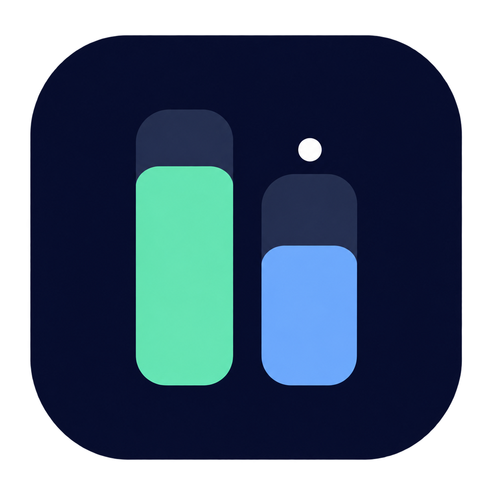
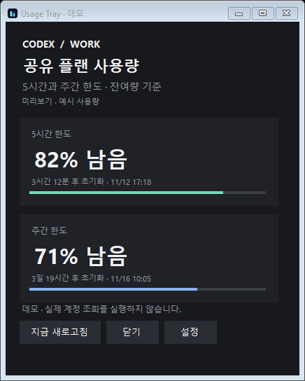

<p align="center">
  
</p>

<h1 align="center">Usage Tray</h1>
<p align="center">Work · Codex의 플랜 사용량을 Windows 작업표시줄에서 확인하세요.</p>
<p align="center">
  
  
  
</p>

<p align="center">
  <a href="#다운로드">다운로드</a> · <a href="#설치와-첫-로그인">설치 방법</a> · <a href="#사용-방법">사용 방법</a> · <a href="#문제-해결">문제 해결</a>
</p>

이 저장소는 **Usage Tray 설치파일과 사용 안내를 배포하는 전용 저장소**입니다.

## 어떤 앱인가요?

작업표시줄에 작은 심볼과 **5시간·주간 잔여율**을 두 줄로 표시하는 Windows 앱입니다. 브라우저의 사용량 페이지를 계속 열어 둘 필요 없이, 로그인한 계정의 사용량을 기본 60초마다 조회합니다.

- **작고 투명한 위젯** — 숫자와 얇은 게이지로 남은 사용량 확인
- **공유 플랜 조회** — Work·Codex 등을 별도 사용량으로 나누지 않고 서버의 플랜 한도 표시
- **영역별 클릭** — 왼쪽 로고 영역은 상세 창, 오른쪽 수치·바 영역은 새로고침
- **위치 이동** — 드래그한 위치 저장, 위치 초기화 제공
- **간단한 설치** — .NET 런타임과 공식 Codex CLI 포함, Node.js 설치·명령어 입력 불필요
- **계정 인증** — 앱의 로그인 버튼 사용, 비밀번호·토큰을 직접 붙여넣을 필요 없음

> `5h`와 `7d`는 **남은 비율**입니다. 모델별 추가 한도를 공유 플랜 한도로 대체하거나, 초기화 시간이 지났다는 이유로 잔여량을 임의로 복구하지 않습니다.

## 미리보기

위젯은 다음처럼 표시됩니다. 아래 수치는 설명을 위한 예시입니다.

```text
 ◉   5h  82% ━━━━━━━━╸
     7d  71% ━━━━━━━╸
```

클릭해서 여는 상세 창의 실제 Windows 데모 실행 화면입니다. 표시된 사용량은 테스트용 예시입니다.

<p align="center"></p>

## 다운로드

**정식 배포본: [v1.4.5](https://github.com/SJSK0517/usage-tray-codex/releases/tag/usage-tray-v1.4.5)**

| PC 종류 | 설치 파일 |
| --- | --- |
| 일반 Windows PC / Intel·AMD | [Windows x64 설치 파일 다운로드](https://github.com/SJSK0517/usage-tray-codex/releases/download/usage-tray-v1.4.5/UsageTray-Setup-win-x64.exe) |
| Windows on ARM / Snapdragon | [Windows ARM64 설치 파일 다운로드](https://github.com/SJSK0517/usage-tray-codex/releases/download/usage-tray-v1.4.5/UsageTray-Setup-win-arm64.exe) |

Releases의 Assets에서 설치 `.exe`를 직접 받으세요. 공개 저장소이므로 GitHub 로그인 없이 다운로드할 수 있습니다. [SHA256SUMS.txt](https://github.com/SJSK0517/usage-tray-codex/releases/download/usage-tray-v1.4.5/SHA256SUMS.txt)로 체크섬을 확인할 수 있습니다.

## 설치와 첫 로그인

**지원 환경:** Windows 11, x64 또는 ARM64, 인터넷 연결과 한도 조회를 지원하는 ChatGPT 계정.

1. PC에 맞는 설치 파일을 다운로드합니다.
2. `UsageTray-Setup-win-x64.exe` 또는 `UsageTray-Setup-win-arm64.exe`를 실행해 **설치**를 누릅니다.
3. 앱에서 **설정 → ChatGPT 로그인**을 선택합니다.
4. 브라우저에서 사용량을 확인할 **같은 계정·워크스페이스**로 로그인합니다.
5. 앱으로 돌아와 **지금 새로고침**을 누릅니다. 이후에는 브라우저를 닫아도 됩니다.

시작 메뉴와 바탕 화면에 바로가기가 생성됩니다. 현재 사용자 계정에 설치하며 관리자 권한을 요구하지 않습니다. 현재 설치 파일은 코드 서명되지 않아 Windows에서 게시자 확인 경고가 표시될 수 있습니다.

> Codex 데스크톱 앱 로그인과 CLI 로그인은 별도일 수 있습니다. API 키 전용 계정 등 플랜 한도 조회를 지원하지 않는 계정에서는 수치를 조회할 수 없습니다.

## 사용 방법

| 동작 | 기능 |
| --- | --- |
| 왼쪽 로고 영역 클릭 | 상세 사용량 창 열기 |
| 오른쪽 수치·게이지 영역 클릭 | 사용량 새로고침 |
| 좌우 드래그 | 위젯 위치 변경·저장 |
| 위젯 우클릭 | 상세 창 열기 / 앱 종료 |
| 상세 창의 **설정** | 로그인, 위치, 조회 간격, 자동 실행 설정 |
| 상세 창의 **닫기** 또는 × | 상세 창 숨기기. 위젯은 계속 실행 |

조회 간격은 **15~900초**로 설정할 수 있습니다. 서버에 반영된 시점의 스냅샷을 주기적으로 조회하는 방식입니다.

- **흰색 숫자:** 잔여율
- **작은 주황색 게이지:** 잔여율 20% 이하
- **`—`:** 해당 기간의 한도 정보 없음
- **회색 표시 / 작은 경고 표시:** 조회 실패·오래된 값 또는 서버의 이용 제한. 상세 창에서 원인을 확인하세요.

**표시 방식:** 기본 모드는 Explorer 작업표시줄의 자식 창에 투명한 표면을 직접 붙입니다. 글자와 클릭 영역이 같은 표면에 있고, 작업표시줄이 활성화될 때 함께 표시됩니다. 이전 버전의 별도 창 기본값은 업데이트 후 한 번 자동 전환됩니다. Windhawk 설치가 필요하지 않으며 Explorer에 코드를 주입하지 않습니다. 다른 작업표시줄 항목의 공간을 자동 확보하지 않으므로, 겹치면 빈 공간으로 옮기세요. 기본 모니터의 가로 작업표시줄을 지원합니다. 작업표시줄 숨김 상태에서는 위젯을 일시적으로 숨깁니다. 전체 화면 앱에서 숨기기는 기본 꺼짐이며 설정에서 선택할 수 있습니다. Windows·Windhawk 구성에 따라 실제 호환성을 확인해야 합니다.

## 업데이트와 삭제

**업데이트:** 실행 중인 앱의 **설정 → 앱 종료** 또는 **위젯 우클릭 → 종료**를 선택한 뒤 새 설치 파일을 실행하세요. ×만 누르면 종료되지 않습니다. 기존 설정과 CLI 로그인은 보존됩니다. 설치 폴더를 옮겼다면 자동 실행 설정을 껐다 켜 주세요.

**삭제:** Windows 설정 → 앱 → 설치된 앱 → Usage Tray → 제거. 자동 실행을 사용했다면 먼저 해제하세요. 앱을 제거해도 사용자 설정과 Codex 로그인 정보는 보존됩니다.

## 문제 해결

<details>
<summary><strong>위젯이 보이지 않아요</strong></summary>

설정 창에서 **별도 창으로 표시**를 끄고 **위치 초기화**를 누르세요. 전체 화면 앱을 닫고 기본 모니터의 작업표시줄을 확인하세요. 계속 안 보이면 설정의 **진단 복사** 내용과 Windows 버전, Windhawk 사용 여부를 [Issues](https://github.com/SJSK0517/usage-tray-codex/issues)에 남겨 주세요.

</details>

<details>
<summary><strong>로그인했는데 사용량이 안 나와요</strong></summary>

설정에서 **ChatGPT 로그인**을 다시 실행하고 같은 계정·워크스페이스인지 확인하세요. CLI 경로를 직접 지정했다면 해당 `codex.exe`가 맞는지 확인하세요. 설치본은 포함된 CLI를 자동으로 찾습니다. 비밀번호, 로그인 토큰, `auth.json` 내용은 공유하지 마세요.

</details>

<details>
<summary><strong>업데이트해도 예전 버전이 실행돼요</strong></summary>

기존 앱을 완전히 종료한 뒤 시작 메뉴의 바로가기로 실행하세요. 이전에 풀어 놓은 ZIP 폴더의 실행 파일과 설치본을 동시에 실행하지 마세요.

</details>

## 데이터와 인증

공식 CLI의 `codex app-server`에 `account/rateLimits/read`를 요청합니다. 인증과 토큰 갱신은 CLI가 담당하며 이 앱은 토큰 파일을 직접 읽거나 복사하지 않습니다. 사용량을 조회하기 위해 대화·작업·모델 호출을 생성하지 않습니다.

사용량은 메모리에만 보관합니다. 앱 설정은 `%LOCALAPPDATA%\LabCodex\UsageTray\settings.json`에 저장합니다. CLI 로그인 정보는 공식 Codex CLI가 별도로 관리합니다.

## 버전과 배포

- [최신 릴리즈](https://github.com/SJSK0517/usage-tray-codex/releases/latest)
- [현재 버전 변경 사항](RELEASE-NOTES.md)
- [배포 담당자 안내](PUBLISHING.md)

설치파일은 Windows x64의 표시·클릭·설치·실행·제거 검사와 x64/ARM64 빌드를 통과한 개발 저장소의 릴리즈에서 복사합니다. 복사 전후 SHA-256을 확인합니다. 이 저장소에 설치파일을 Git 파일로 커밋하지 않고 Releases에 올립니다.

## 참고 및 배포 범위

- [OpenAI Codex](https://github.com/openai/codex): 포함된 CLI의 소스·라이선스 정보는 설치 폴더의 `cli/CODEX-LICENSE.txt`, `cli/SOURCE.txt`에서 확인할 수 있습니다.
- [SessionWatcher](https://sessionwatcher.com/guides/how-to-check-codex-usage): 간결한 사용량 표시 구성의 디자인 참고.

이 프로젝트는 OpenAI 또는 SessionWatcher의 공식 제품이 아닙니다. 앱 자체의 별도 이용·재배포 라이선스는 아직 지정하지 않았으며, 포함된 타사 구성 요소에는 각 라이선스가 적용됩니다.
